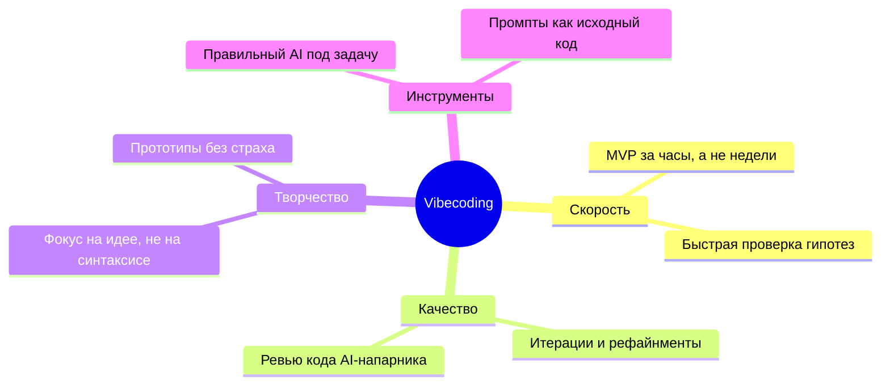

<div align="center">

# ⚡ ВАСИЛИЙ ДЕМЬЯНЕНКО ⚡

### *Vibe Coder · Builder of Ideas · Prompt-Driven Developer*


</div>

---

## 🎯 Кто я

Привет! Я — **вайбкодер**: строю цифровые продукты «на вайбе» — описываю идею словами, а код пишут мои AI-напарники 🤖✨

Мой подход прост:

```
 💡 Идея  →  💬 Промпт  →  🤖 AI  →  🔧 Итерации  →  🚀 Готовый продукт
```

Вайбкодинг для меня — это не «код без усилий», а **пару танец человека и ИИ**: я задаю видение, архитектурные решения и вкус; AI берёт на себя рутину. Я глубоко разбираюсь в том, **что** и **почему** строю, а механику реализации доверяю своим цифровым коллегам.

> *"The best way to predict the future is to prompt it."* 🎯

---

## 🛠️ Арсенал вайбкодера

<div align="center">

| Категория | Инструменты |
|---|---|
| 🤖 AI-агенты |  |
| 💻 AI-редакторы |   |
| 💬 Веб-чаты |   |
| ⚙️ Платформы |  |
| 🧠 Скиллы | Промпт-инжиниринг · Декомпозиция задач · Быстрые прототипы |

</div>

---

## 🌈 Что я делаю

### 🌐 Веб-приложения и сайты
Собираю веб-проекты от идеи до деплоя: лендинги, интерактивные страницы, дашборды, SPA. Быстрые прототипы за вечер — нормально. Довожу их до красивого, работающего продукта.

### ⚡ Скрипты для оптимизации работы
Автоматизирую рутину: скрипты для процессов, генерация отчётов, чистка файлов, обвязка вокруг рабочих потоков. Мой девиз: *«Если делал руками дважды — пусть сделает бот»* 🦾

### 🧪 Эксперименты / Разное
Песочница идей: демо, тесты гипотез, «а что если…», странные но крутые эксперименты на стыке AI и веба. Часть проектов рождается из «хочу проверить одну штуку» — и это отличный способ учиться.

---

## 🔥 Философия вайбкодинга



**Мои принципы:**
- 🎯 **Промпт — это спецификация.** Чётко описал → получил ровно это.
- 🔁 **Итерируй без страха.** Не так? Переформулировал → стало так.
- 🧠 **Понимаю, что строю.** AI пишет — я отвечаю за архитектуру и решения.
- 🚀 **Done > Perfect, но Perfect достижим за 3 итерации.** 😎

---

## 📊 Статистика

<div align="center">


</div>
---

## 🤝 Связаться со мной

<div align="center">

<a href="mailto:basil-va@yandex.ru"></a>

</div>

---

<div align="center">

### 💜 «Вайб правильный — код работает» 💜


⭐️ Звёзды на профилях вдохновляют меня делать больше экспериментов ⭐️

</div>
